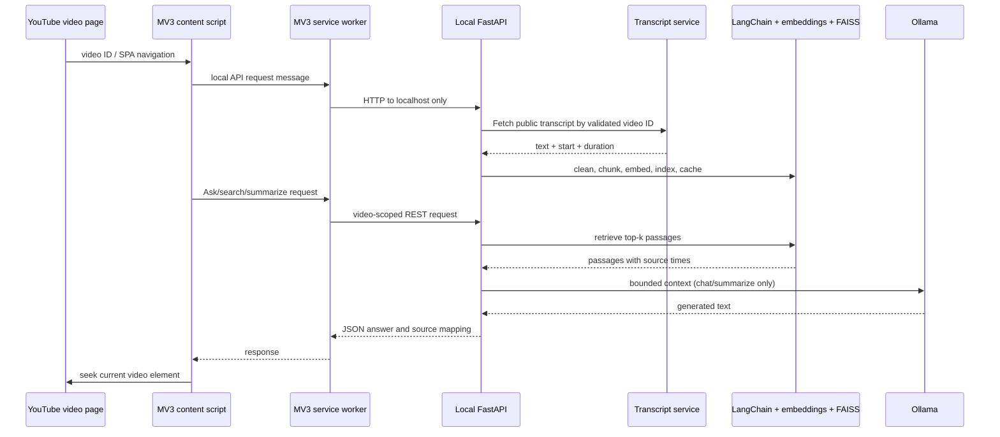

# Architecture

## Runtime boundaries

## Components

- `extension/content/content.js`: identifies watch, shorts, and embed IDs; renders a closed-over shadow-root UI; listens for YouTube SPA navigation; calls the worker; seeks the existing `<video>` element. Transcript-derived text uses `textContent` or text nodes.
- `extension/background/service-worker.js`: restricts routes to `/api/` and contacts only the two configured localhost origins. It converts HTTP failures to structured extension responses.
- `backend/app/main.py`: typed FastAPI routes, explicit CORS policy, predictable validation and application error envelopes, and lifecycle-owned runtime.
- `backend/app/services/transcripts.py`: validates video IDs, fetches with the current `youtube-transcript-api` object API, cleans markup/whitespace, deduplicates only exact adjacent fragments, and retains start/duration.
- `backend/app/rag/chunking.py`: builds the timestamp trace over the source string and applies LangChain's token-aware recursive splitter. Each output document maps to the union of the source segments it overlaps.
- `backend/app/rag/embeddings.py`: lazily loads the configured CPU sentence-transformer. It is not loaded until an index is needed.
- `backend/app/rag/vector_store.py`: a small LangChain `VectorStore` adapter over normalized inner-product FAISS search. This keeps LangChain document/retriever interfaces without relying on the sunset community integration package.
- `backend/app/rag/cache.py`: stores versioned, per-video artifacts. Raw FAISS binary is checked by SHA-256 before native read; document records and index ID mapping are JSON. Cache paths are user-private on POSIX. No pickle file is used.
- `backend/app/services/runtime.py`: controls initialization status, in-memory video/session scope, retrieval, follow-up question reformulation, grounding prompts, abstention threshold, and hierarchical summaries.

## Processing lifecycle

`POST /api/videos/initialize` schedules work and returns promptly. A status resource progresses through transcript lookup, splitting, embedding, and persistence. Transcript cache hits skip network fetch. A matching index cache hit skips embedding generation. Any cache mismatch (video, transcript, embedding model, format version, checksum, or expiry) causes the index to be rebuilt. All cache directories are derived from the validated 11-character video ID.

The service keeps prepared indexes and sessions in process memory for the current backend lifetime. On restart, a cached index can still be read when the video is initialized again. In-progress work is not durable across restarts.

## Retrieval and citation flow

Queries are embedded and searched against a normalized `IndexFlatIP` FAISS index. This is exact cosine ranking for normalized vectors. The application carries the retrieved LangChain document metadata alongside the score. The answer receives only top-k retrieved passages, each labeled with a generated local source ID and timestamp. The JSON response contains the same source IDs and the validated start seconds; the extension maps `[S1]` markers only to returned objects, and seeks the current player's video element.

The IDs make the mapping auditable; they do not prove a generated claim is supported. The evaluation docs describe a manual groundedness review process.

## Sessions and context limits

Session IDs are random and scoped to one video. The runtime retains at most the last eight user/assistant turns (16 messages); a prompt uses at most the most recent six messages. Pronoun-like follow-ups can be rewritten into standalone search queries by the configured local chat model. If rewriting fails, retrieval uses the original text. Clearing a session removes its history.

## Long video summaries

All chunks are divided into batches with a character ceiling, each batch receives an intermediate summary, and the application repeatedly reduces large summary lists in groups of at most eight. A final pass formats the selected summary type. This bounds each model request; quality still depends on the configured Ollama model and is not benchmarked automatically.

## Security choices

- IDs and request lengths are schema-validated; the server does not accept arbitrary URLs.
- CORS permits explicit local origins and Chrome extension origins. The server listens on loopback by default.
- The extension has no broad `tabs`, `activeTab`, `scripting`, or `webRequest` permissions.
- The content script does not inject executable code or remote code.
- Transcript text is delimited and described as untrusted in LLM instructions, then rendered safely in the DOM.
- Cache metadata is JSON; code never enables LangChain's dangerous pickle deserialization.
