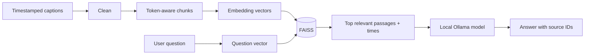

# RAG explained

RAG means **retrieval-augmented generation**. The app first finds pieces of a video's transcript that match the question. Then it asks a language model to answer using only those pieces. This is more focused than sending a whole long transcript with every question.

## The pipeline

1. **Fetch transcript:** the backend uses the video's validated 11-character ID. Each caption segment supplies text, a start time, and a duration. The backend does not synthesize captions if this request fails.
2. **Clean text:** markup and repeated whitespace are removed. Exact adjacent duplicate caption fragments are dropped, but distinct repeated phrases remain.
3. **Chunk:** LangChain's recursive splitter divides the combined text at natural boundaries while measuring with a tokenizer. The default is 320 tokens with 64 tokens of overlap. A 320-token window fits beneath the 384 wordpiece limit of the default MiniLM embedding model; overlap helps keep a definition or sentence that crosses a boundary in both neighboring chunks.
4. **Keep time links:** the chunk's character range is compared with the original segment ranges. A chunk stores the earliest start and latest end of the transcript snippets it overlaps, as well as video ID and language.
5. **Embed:** a sentence-transformer converts each chunk into a list of numbers. Similar meanings tend to have vectors pointing in similar directions. The library batches the document embedding calls.
6. **Index:** FAISS stores normalized vectors. At question time it embeds the question and compares it to each vector using inner product, which equals cosine similarity for normalized vectors.
7. **Retrieve:** the highest-ranked chunks are returned with their scores and original timestamps. Search stops here; it does not need an LLM.
8. **Generate:** chat sends a small set of retrieved passages plus the question and bounded prior conversation to Ollama. Each passage has a local ID such as `[S1]`; the API returns the corresponding timestamp metadata separately.

## Why not pass every transcript word to the model?

Long videos may exceed model context limits, and irrelevant paragraphs can distract answer generation. Retrieval gives the model a smaller, question-focused set. Summaries use a different pattern: bounded transcript batches are summarized and then reduced into an overall result.

## What FAISS does here

FAISS is a vector search library. One independent index is stored per YouTube video, so a search cannot accidentally return another video's chunks. This project uses an exact flat index because a single local transcript normally has a manageable chunk count and exact ranking is simple to inspect. It persists the FAISS binary plus separate JSON document metadata.

## Scores and abstention

Search result scores are similarity values, not calibrated probabilities. The chat path uses a configurable minimum score to avoid sending weak matches to the model. That threshold is a practical guard, not a proof that a high-scoring passage answers correctly. Source IDs verify which retrieved passage a citation maps to; they do not verify the model's reasoning.

## Prompt injection and data trust

Caption text can contain arbitrary words, including text that looks like instructions. The backend labels passages as untrusted and instructs the model not to follow their instructions. This reduces risk but cannot guarantee perfect resistance. UI rendering uses text nodes rather than HTML interpretation.

## Main files to study

- Transcript schema and retrieval: `backend/app/services/transcripts.py`
- Time-preserving split: `backend/app/rag/chunking.py`
- FAISS and cache: `backend/app/rag/cache.py`
- Retrieval, prompts, sessions, summaries: `backend/app/services/runtime.py`
- API types and routes: `backend/app/models/schemas.py`, `backend/app/main.py`
