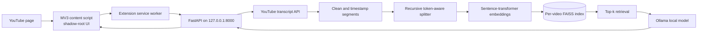

# YouTube AI Assistant

A local-first Chrome extension and FastAPI service for asking questions about a YouTube video's available transcript. It uses timestamped transcript segments, token-aware chunking, Hugging Face sentence-transformer embeddings, FAISS retrieval, and a locally running Ollama model.

This repository was created as an educational portfolio project. It has no hosted service, accounts, API keys, or third-party LLM calls. Transcript text and the index are kept in the backend's local cache directory. The extension contacts only the local backend.

## Features

- Ask video-specific questions and ask follow-ups within an in-memory session.
- Search the transcript semantically without calling the LLM.
- Jump the YouTube player to a retrieved segment.
- Generate quick, detailed, chapter-style summaries, and study notes.
- Cache transcripts and FAISS indexes per video; validate index files by format version and checksums.
- Use a responsive shadow-DOM sidebar with light/dark theme, copy, retry, and session reset controls.
- Use a small deterministic synthetic evaluation set without downloading an embedding model.

## Architecture



See [ARCHITECTURE.md](ARCHITECTURE.md) for component and data-flow details, and [RAG_EXPLAINED.md](RAG_EXPLAINED.md) for a beginner-friendly RAG walkthrough.

## Tech stack

- Chrome Extension Manifest V3, JavaScript, CSS, Chrome storage/runtime APIs
- Python 3.11–3.13, FastAPI, Pydantic v2, HTTPX
- LangChain Core documents/vector-store interfaces, LangChain text splitters, LangChain Hugging Face, LangChain Ollama
- `sentence-transformers/all-MiniLM-L6-v2` by default, FAISS CPU
- `youtube-transcript-api` timestamped transcript retrieval
- Ollama with `mistral:7b` by default; `qwen2.5:3b` is a smaller configurable option

Dependencies are bounded by compatible major versions in [backend/requirements.txt](backend/requirements.txt). The current transcript library API is instantiated with `YouTubeTranscriptApi().fetch(video_id, languages=[...])`; all retrieved snippets retain their start and duration metadata.

## Requirements

- macOS, Linux, or Windows with Python 3.11–3.13
- Google Chrome or Chromium
- Internet access to retrieve public YouTube captions and download the first embedding model
- Ollama for generated answers and summaries (semantic search can work without Ollama after indexing)
- Enough memory for your selected embedding and Ollama models. Mistral 7B may need substantial RAM; set `YTA_OLLAMA_MODEL=qwen2.5:3b` for a smaller local model.

## Install and run

### 1. Install and start Ollama

Install Ollama using the official installer for your operating system, then pull one model:

```bash
ollama pull mistral:7b
# or, for a smaller model:
ollama pull qwen2.5:3b
ollama serve
```

If Ollama is already running as a system service, `ollama serve` may report that its port is occupied; use the existing service. Keep the Ollama API bound to localhost.

### 2. Set up the Python backend

```bash
cd backend
python3.13 -m venv .venv  # Python 3.11 and 3.12 are also supported
source .venv/bin/activate
python -m pip install --upgrade pip
python -m pip install -e .
cp .env.example .env
uvicorn app.main:app --host 127.0.0.1 --port 8000
```

On Windows, activate with `.venv\Scripts\activate`. Set `YTA_OLLAMA_MODEL=qwen2.5:3b` in `.env` if using the smaller model. On the first video, the sentence-transformer package downloads the configured embedding model to the user's normal model cache. Model weights are not stored in this repository.

The API is local-only by default. Interactive OpenAPI docs are at `http://127.0.0.1:8000/docs`, and health is at `http://127.0.0.1:8000/api/health`.

### 3. Load the Chrome extension

1. Open `chrome://extensions`.
2. Enable **Developer mode**.
3. Choose **Load unpacked** and select this repository's `extension/` folder.
4. Open a YouTube video. Click the floating ✦ button at the right edge.
5. On first use, allow time for transcript retrieval, embedding-model download, and indexing. The status line reports progress.

For a portfolio screenshot, load the extension on a video with public captions, wait for the status message to clear, then capture the panel with the Ask and Search tabs visible in separate images. Record the video ID, browser size, and Ollama model used; do not include personal account details.

No extension icon popup is needed; the panel is injected on YouTube video pages. The `extension/` directory can be selected directly as the unpacked extension.

## Use it

- **Ask:** enter a video question; cited source timestamps seek the current player.
- **Summary:** select quick, detailed, or chronological chapter output.
- **Search:** describe a topic or example; results show matching excerpts and relevance scores.
- **Notes:** generate definitions, concepts, examples, and review questions.
- **Clear chat:** drops the backend's in-memory conversation session.
- **Retry:** checks or reinitializes transcript processing for the current video.

Switching videos clears the extension's displayed messages and creates a new video-scoped backend session. Conversation sessions are in-memory and are lost when the backend restarts.

## API

All request and response schemas are in [backend/app/models/schemas.py](backend/app/models/schemas.py); API routes are in [backend/app/main.py](backend/app/main.py).

| Method | Route | Purpose |
|---|---|---|
| `GET` | `/api/health` | Backend and Ollama reachability |
| `POST` | `/api/videos/initialize` | Queue transcript processing and indexing |
| `GET` | `/api/videos/{video_id}/status` | Processing state and progress |
| `POST` | `/api/videos/{video_id}/ask` | Grounded chat, with source IDs and timestamp URLs |
| `POST` | `/api/videos/{video_id}/search` | Embedding/FAISS search without LLM generation |
| `GET` | `/api/videos/{video_id}/timestamps?query=...` | Search passages as timestamp results |
| `POST` | `/api/videos/{video_id}/summarize` | `quick`, `detailed`, `chapters`, or `notes` |
| `POST` | `/api/sessions` | Create an in-memory session for an indexed video |
| `DELETE` | `/api/sessions/{session_id}?video_id=...` | Clear a matching video-scoped session |

Errors use `{ "error": { "code": "...", "message": "..." } }`; request validation errors include a `details` array. `video_id` must be exactly 11 URL-safe YouTube ID characters. CORS permits the configured localhost development origins and Chrome extension origins.

## Testing and evaluation

Install the dev test dependency and run deterministic tests:

```bash
cd backend
python -m pip install -e '.[test]'
pytest
```

For the documented lint check, install `python -m pip install -e '.[lint]'` and run `ruff check app tests ../evaluation` from `backend/`.

Or, without installing the editable project, install `requirements.txt` and `pytest>=8,<9`. Tests use a local deterministic feature-hashing embedding double and fake LLM; they do not access YouTube, download neural model weights, or require Ollama.

Run the reproducible retrieval evaluation:

```bash
python ../evaluation/run.py
```

The evaluation intentionally uses a deterministic lexical-hash embedding on a six-passage synthetic transcript. It measures retrieval plumbing, timestamps, and cache reuse, not semantic-transformer quality or LLM answer quality. The measured output from the last local run is recorded in [docs/VALIDATION.md](docs/VALIDATION.md); no real-model latency or answer-quality number is claimed.

For real local end-to-end timings after Ollama and the backend are running, use `python ../evaluation/benchmark_live.py VIDEO_ID`. It reports transcript/index processing time and time from initialization through the first generated answer. The first run includes cold-cache/model-load costs; report warm runs separately.

Grounded answer review protocol: run the five questions in `evaluation/dataset.json` with Ollama enabled; check whether each factual claim appears in the cited transcript chunk, whether its citation identifier maps to the actual chunk, and whether unsupported questions abstain. Record reviewer, model, and failures before reporting any quality score. Citation links establish a source mapping, not factual correctness.

## Performance and cache

Chunk size defaults to 320 `cl100k_base` tokens with 64-token overlap. The window remains under the default MiniLM model's 384 wordpiece input limit with room for special tokens; overlap retains short context at boundaries. Each chunk stores its source time span. Long transcripts are chunked across all received segments, including two-hour fixture coverage.

The cache is under `backend/.cache/youtube-ai-assistant/<video_id>/`. A transcript JSON file and a versioned FAISS binary index are keyed and checked by video ID, transcript SHA-256, embedding-model name, chunk size/overlap, and payload checksums. The index is read with FAISS's native reader; document/ID metadata uses JSON, not Python pickle. Cache expiry defaults to seven days. Change the model or chunk configuration, remove that video's cache directory, or use `force: true` on initialization to rebuild. Cache files are user-private on POSIX systems. Do not put untrusted index files into the cache.

Actual performance varies by machine, model loading, transcript length, and Ollama setup. The evaluation output reports measured timings for its small deterministic fixture only. A first real answer additionally includes transcript fetch, local model download/loading, and LLM generation, none of which are represented by that fixture.

## Privacy and security notes

- Extension network calls go to `127.0.0.1:8000` or `localhost:8000` only.
- Transcript text is treated as untrusted prompt content; the model is instructed to ignore transcript instructions.
- Retrieved citations are rendered with DOM text nodes, never transcript-derived HTML.
- Backend configuration and model inference remain outside the extension.
- The backend binds to `127.0.0.1` by default and CORS has an explicit local/extension allowlist.
- Local transcripts and indexes persist until cache expiry or manual cache deletion. Session history stays in memory and is bounded.

## Known limitations

- YouTube can block transcript retrieval by region/IP, and age-restricted, private, disabled-caption, or inaccessible videos may not expose captions. The backend reports the failure instead of inventing content.
- English is requested by default; language preferences can be supplied to initialization. The extension currently offers English as its default UI selection.
- Chat history and status are memory-resident; there is no user authentication or multi-user deployment boundary. Do not expose the development server to a network.
- There is no streaming LLM response yet; answers appear after Ollama finishes.
- Summaries use bounded transcript batches followed by reduction. A very large video may require many local model calls.
- FAISS uses exact inner-product search, suitable for a local single-video index; no approximate index or cross-video corpus is needed here.
- Chrome/player behavior should be validated in a real Chrome session. The automated suite validates frontend JavaScript syntax and backend behavior, not end-to-end browser UI interaction.

## Learning path and interview prep

Start at [LEARNING_GUIDE.md](LEARNING_GUIDE.md), then review [INTERVIEW_GUIDE.md](INTERVIEW_GUIDE.md) for 30 implementation-specific questions.

## CV bullets

These bullets distinguish implemented features from synthetic-fixture measurements. They do not claim real-user or production performance.

- Built a Manifest V3 YouTube assistant with a shadow-DOM sidebar, SPA video switching, and timestamp seeking.
- Implemented a FastAPI transcript pipeline that preserves segment timestamps through configurable token-aware LangChain chunking.
- Developed a local RAG workflow using Hugging Face sentence-transformer embeddings, per-video FAISS retrieval, and Ollama-grounded answers with mapped timestamp citations.
- Added versioned transcript/index caching with SHA-256 validation and JSON/FAISS persistence that avoids pickle deserialization.
- **Measured on a synthetic fixture:** achieved Recall@3 1.00, MRR@3 1.00, and top-1 timestamp accuracy 1.00 over five questions using deterministic feature-hashing embeddings; real-model quality remains unmeasured.
